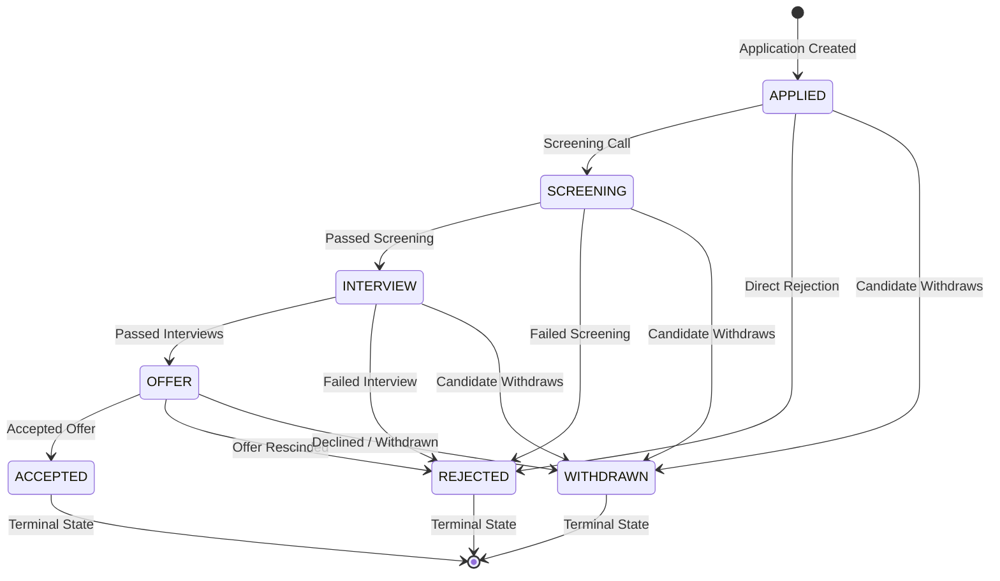
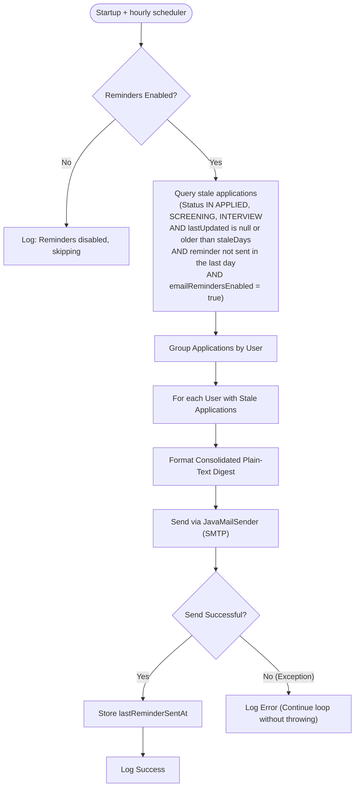
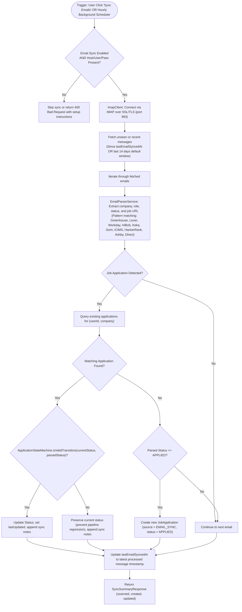
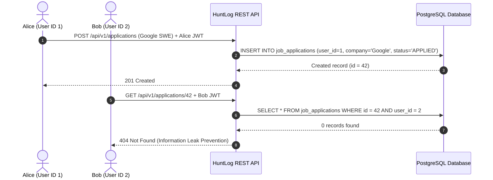
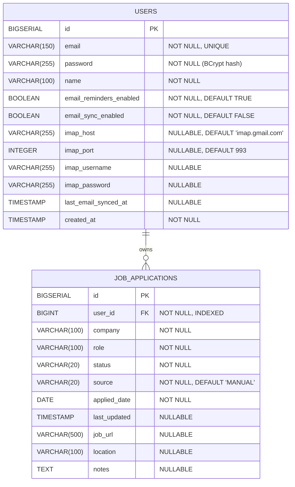

# HuntLog — System Architecture and Technical Design

This document details the architectural decisions, design patterns, state machine mechanics, security model, reminder scheduling pipeline, automated mailbox synchronization system, database schema, and frontend architecture for HuntLog.

---

## 1. High-Level Architecture and Request Flow

HuntLog follows a layered, domain-driven Spring Boot architecture with strict separation of concerns.

```mermaid
flowchart TD
    Client(["Client (Browser SPA / cURL)"])
    
    subgraph SpringSecurity ["Security and Authentication Layer"]
        JwtFilter["JwtAuthenticationFilter\n(Extracts and Validates Bearer Token)"]
        SecurityCtx["SecurityContextHolder\n(Stores Authenticated User ID and Email)"]
    end

    subgraph ControllerLayer ["Controller Layer"]
        AuthCtrl["AuthController\n(/api/v1/auth/**)"]
        AppCtrl["JobApplicationController\n(/api/v1/applications/**)"]
        AnalyticsCtrl["AnalyticsController\n(/api/v1/analytics)"]
        UserCtrl["UserController\n(/api/v1/users/**)"]
        SyncCtrl["EmailSyncController\n(/api/v1/sync/**)"]
        Actuator["Actuator Endpoint\n(/actuator/health)"]
    end

    subgraph ServiceLayer ["Business Logic and Domain"]
        AuthService["AuthService\n(BCrypt Hashing, Token Generation)"]
        AppService["JobApplicationService\n(User Scoping and Pipeline Validation)"]
        AnalyticsService["AnalyticsService\n(Metrics, Response Rates, Projections)"]
        UserService["UserService\n(User Preferences and Credentials)"]
        ReminderService["ReminderService\n(Scheduled Stale Pipeline Scanner)"]
        EmailService["EmailService\n(JavaMailSender SMTP Dispatcher)"]
        EmailSyncService["EmailSyncService\n(Sync Orchestration and Deduplication)"]
        ImapClient["ImapClient\n(Jakarta Mail IMAP over TLS/SSL)"]
        EmailParserService["EmailParserService\n(ATS Regex and Status Heuristics)"]
        StateMachine["ApplicationStateMachine\n(Enum State Transition Validator)"]
    end

    subgraph PersistenceLayer ["Persistence Layer"]
        UserRepo[("UserRepository\n(users table)")]
        AppRepo[("JobApplicationRepository\n(job_applications table)")]
        PostgreSQL[("PostgreSQL 16 Database\n(Flyway Migrations V1-V5)")]
    end

    subgraph ExternalMail ["Mail Services"]
        SMTP["SMTP Server\n(Mailtrap / Gmail :587)"]
        IMAP["IMAP Server\n(Gmail / Mailbox :993)"]
    end

    Client -->|Public Static Files, Health, or Auth| AuthCtrl
    Client -->|Authenticated Request with Bearer Token| JwtFilter
    JwtFilter -->|Populates| SecurityCtx
    JwtFilter -->|Routes Request| AppCtrl
    JwtFilter -->|Routes Request| AnalyticsCtrl
    JwtFilter -->|Routes Request| UserCtrl
    JwtFilter -->|Routes Request| SyncCtrl
    
    AuthCtrl --> AuthService
    AuthService --> UserRepo
    AuthService -->|Issues JWT| Client
    
    AppCtrl --> AppService
    AppService --> SecurityCtx
    AppService --> StateMachine
    AppService --> AppRepo

    UserCtrl --> UserService
    UserService --> SecurityCtx
    UserService --> UserRepo
    
    AnalyticsCtrl --> AnalyticsService
    AnalyticsService --> SecurityCtx
    AnalyticsService --> AppRepo

    SyncCtrl --> EmailSyncService
    EmailSyncService --> SecurityCtx
    EmailSyncService --> UserRepo
    EmailSyncService --> ImapClient
    EmailSyncService --> EmailParserService
    EmailSyncService --> StateMachine
    EmailSyncService --> AppRepo
    ImapClient -->|Fetch via TLS SSL 993| IMAP

    ReminderService --> AppRepo
    ReminderService --> EmailService
    EmailService -->|Dispatch via STARTTLS 587| SMTP
    
    UserRepo --> PostgreSQL
    AppRepo --> PostgreSQL
```

---

## 2. State Machine Pipeline

HuntLog enforces hiring lifecycle rules using a deterministic finite state machine to prevent illegal status transitions (such as jumping directly from `APPLIED` to `OFFER`).

### Transition Matrix

| Current Status | Allowed Next Statuses | Terminal State |
|---|---|---|
| `APPLIED` | `SCREENING`, `REJECTED`, `WITHDRAWN` | No |
| `SCREENING` | `INTERVIEW`, `REJECTED`, `WITHDRAWN` | No |
| `INTERVIEW` | `OFFER`, `REJECTED`, `WITHDRAWN` | No |
| `OFFER` | `ACCEPTED`, `REJECTED`, `WITHDRAWN` | No |
| `ACCEPTED` | *None* | Yes |
| `REJECTED` | *None* | Yes |
| `WITHDRAWN` | *None* | Yes |

### Implementation Detail
The state machine is implemented via an immutable `Map<ApplicationStatus, Set<ApplicationStatus>>` in `ApplicationStateMachine.java`. Lookups operate in constant time O(1).

Every API response embeds `allowedNextStatuses: [...]`, enabling client frontends to dynamically render next actions without duplicating transition rules in JavaScript.

### State Machine Enforcement during Email Synchronization
When incoming status updates are parsed from mailbox emails (e.g. interview invitations, offer letters, or rejection notices), `EmailSyncService` strictly validates the proposed status change through `ApplicationStateMachine.isValidTransition(existing.getStatus(), parsedStatus)`:
- If a candidate has already progressed to the `INTERVIEW` stage and an earlier automated acknowledgment email arrives with `APPLIED` status, the transition is rejected to prevent regressing application state.
- Terminal statuses (`ACCEPTED`, `REJECTED`, `WITHDRAWN`) cannot transition to any other status.
- Valid forward transitions update the status, refresh `lastUpdated`, and append chronological audit notes.
- If an email status cannot advance the pipeline (e.g. redundant acknowledgment or lateral event), the current state is preserved and informative notes are recorded without corrupting candidate history.

---

## 3. Automated Reminder Pipeline

The reminder subsystem identifies neglected job applications and sends consolidated email digests:

### Key Engineering Guarantees
- **Consolidation**: Stale applications are grouped per user so candidates receive one unified summary email instead of multiple disjointed messages.
- **Fault Isolation**: Email dispatch failures for one user are logged without terminating the loop, ensuring remaining users still receive their reminders.
- **Scoped Querying**: Uses JPQL with `JOIN FETCH` to prevent N+1 queries when loading user details.

---

## 4. Automated Mailbox Synchronization Pipeline

HuntLog includes an automated background and on-demand mailbox synchronization engine powered by Jakarta Mail IMAP over TLS/SSL (port 993) and heuristic applicant tracking system (ATS) parsing.

### Heuristic ATS Parsing Engine (`EmailParserService`)
The parser inspects email headers (`From`, `Subject`) and body contents (plain text and HTML) to classify messages and extract metadata:

| ATS Provider / Source | Detection Signature | Extracted Metadata | Default Classified Status |
|---|---|---|---|
| **Greenhouse** | `no-reply@greenhouse.io` or `greenhouse-mail.io` | Company and Role from subject patterns (`Application for <Role> at <Company>`) | `APPLIED` / `INTERVIEW` / `REJECTED` |
| **Lever** | `no-reply@hire.lever.co` or `jobs.lever.co` | Company, Role, and Lever application URLs | `APPLIED` / `INTERVIEW` / `REJECTED` |
| **Workday** | `myworkday.com` or `myworkdayjobs.com` | Company and Role from Workday candidate notifications | `APPLIED` / `INTERVIEW` |
| **HiBob** | `hibob.com` or `bob-notifications` | Company, Role, and candidate portal links | `APPLIED` / `INTERVIEW` |
| **Keka** | `keka.com` or `kekacareers` | Company, Role, and assessment links | `APPLIED` / `INTERVIEW` |
| **Gem** | `gem.com` or `gem-mail` | Sponsoring company and recruiter outreach position | `APPLIED` / `INTERVIEW` |
| **iCIMS** | `icims.com` candidate center | Company, Role, and candidate submission reference | `APPLIED` |
| **HackerRank** | `hackerrank.com` assessment invitations | Company inviting the candidate, assessment role | `INTERVIEW` (Technical Screen) |
| **Ashby** | `ashbyhq.com` or `jobs.ashbyhq.com` | Company, Role, and Ashby application confirmation | `APPLIED` / `INTERVIEW` |
| **Direct Recruiting** | Subject patterns: `Thank you for applying to <Company>`, `Interview with <Company>` | Company, Role, and status keywords | Dynamic based on keywords |

### Status Classification Rules
- **`APPLIED`**: Matched when emails contain confirmation phrases (`thank you for applying`, `application received`, `we have received your application`, `application submitted`).
- **`INTERVIEW`**: Matched when emails contain interview or evaluation triggers (`invitation to interview`, `coding challenge`, `technical assessment`, `phone screen`, `schedule interview`, `availability for a call`).
- **`REJECTED`**: Matched when emails contain adverse decisions (`unfortunately`, `not moving forward`, `other candidates whose qualifications`, `decided to pursue other applicants`).
- **`OFFER`**: Matched when emails convey formal job proposals (`offer of employment`, `job offer`, `congratulations on your offer`).

### Deduplication and Checkpoint Guarantees
- **Exact and Normalized Matching**: Matches incoming emails against existing user applications by company name and normalized title (lowercased, punctuation removed).
- **Forward-Only Pipeline Safety**: An incoming `APPLIED` email received after an interview invitation was already logged will not regress the application status.
- **Persistent Timestamp Checkpoint**: Each user record stores `last_email_synced_at`. Subsequent scans only fetch messages received after this timestamp, reducing network traffic and eliminating duplicate processing.
- **Auditable Tracking**: Applications created or updated via mailbox synchronization set `source = 'EMAIL_SYNC'`, displayed as a distinct badge in the UI.

---

## 5. Frontend Architecture

The frontend is implemented as a lightweight Single Page Application (SPA) without third-party frameworks:
- **Location**: `src/main/resources/static/` (`index.html`, `styles.css`, `app.js`).
- **Routing**: Hash-based routing (`#login`, `#register`, `#dashboard`, `#view-settings`) with immediate redirection if unauthenticated.
- **Email Sync Controls**:
  - **Top Navigation Action**: Instant "Sync Emails" button triggering `POST /api/v1/sync/emails` with spinning animation and status feedback.
  - **Settings Panel**: Dedicated "Email Auto-Sync" section allowing users to toggle background syncing, specify IMAP server host and port (defaulting to `imap.gmail.com:993`), provide Google App Passwords, inspect last sync timestamp, and run manual scans.
  - **Visual Badges**: Distinguishes manual submissions (`MANUAL`) from automated imports (`EMAIL_SYNC`) with distinct metadata badges.
- **Single Service Integration**: Served directly from Spring Boot alongside the REST API, avoiding CORS configuration issues across cloud deployments.
- **State Management**: Lightweight client-side application caching for real-time search and filter without redundant network queries.
- **Security**: JWT stored in `localStorage` for simple client persistence, sent via standard `Authorization: Bearer <token>` headers. IMAP passwords are never exposed to the client; `hasImapPassword: true` is returned instead.

---

## 6. Analytics and Metrics Pipeline

The `AnalyticsService` executes user-scoped aggregate queries to compute real-time metrics:

- **Database Aggregation**: Utilizes Spring Data JPA projections (`CompanyCount`) to calculate top company distribution in PostgreSQL without loading entire entity collections into memory.
- **Response Rate Formula**:
  $$\text{Response Rate} = \frac{\text{Total} - \text{APPLIED} - \text{WITHDRAWN}}{\text{Total}} \times 100$$
- **Velocity Metrics**: Calculates average days from application submission to first status update for active candidates.

---

## 7. Security and Multi-Tenant Data Isolation

### Stateless Authentication
- **Algorithm**: HMAC-SHA512 (`HS512`) with 256+ bit secret keys.
- **Payload Claims**: `sub` (email), `userId` (Long), `name` (String), `iat` (issued at), `exp` (expiration).
- **Password Storage**: Encrypted with `BCryptPasswordEncoder` (salted, 10 rounds).

### Per-User Data Isolation
Every application record is associated with a `user_id` foreign key.

Attempting to access or modify another user's application produces a `404 Not Found` rather than `403 Forbidden`, preventing unauthorized discovery of entity IDs.

---

## 8. Database Schema and Migrations

Database schema versioning is managed via Flyway migrations under `src/main/resources/db/migration`:

### Entity Relationship Diagram

### Migrations Timeline
- `V1__create_job_applications.sql`: Creates initial `job_applications` table with `BIGSERIAL` primary key and timestamps. Do not edit after deployment.
- `V2__create_users_and_link_applications.sql`: Creates `users` table, adds `user_id` foreign key constraint, and indexes `idx_job_applications_user_id`.
- `V3__add_email_preferences.sql`: Adds `email_reminders_enabled` boolean column to `users` table for user notification controls.
- `V4__add_reminder_tracking.sql`: Adds `last_reminder_sent_at` to prevent duplicate reminder emails.
- `V5__add_email_sync_settings.sql`: Adds mailbox synchronization columns (`email_sync_enabled`, `imap_host`, `imap_port`, `imap_username`, `imap_password`, `last_email_synced_at`) to the `users` table, adds `source` column to `job_applications` (distinguishing `MANUAL` vs `EMAIL_SYNC`), and creates performance index `idx_job_applications_user_company` on `(user_id, company)`.

---

## 9. Global Exception and Error Handling

All controller errors are processed by `GlobalExceptionHandler` and returned in a standard RFC 7807 format:

| Exception | HTTP Status | Meaning |
|---|---|---|
| `DuplicateEmailException` | `409 Conflict` | Email is already registered |
| `BadCredentialsException` | `401 Unauthorized` | Invalid email or password |
| `ResourceNotFoundException` | `404 Not Found` | Application not found or belongs to another user |
| `InvalidStatusTransitionException` | `422 Unprocessable Entity` | Illegal state machine status transition |
| `MethodArgumentNotValidException` | `400 Bad Request` | DTO validation failure (e.g. invalid email) |
| `HttpMessageNotReadableException` | `400 Bad Request` | Malformed JSON in request body |
| `IllegalStateException` | `400 Bad Request` | Mailbox synchronization is disabled or IMAP credentials are not configured |
